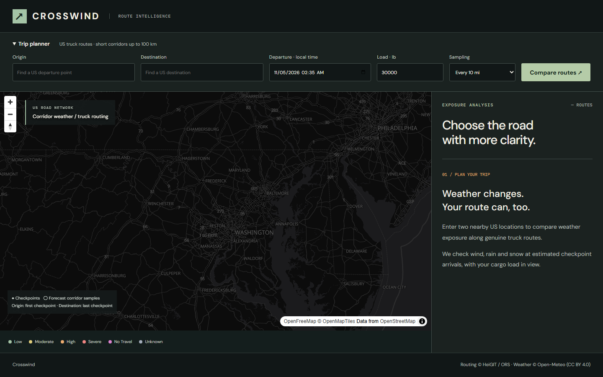

# Crosswind — Weather-Aware Truck Routing

Crosswind compares truck routes by weather exposure at predicted arrival times.
The dark, map-first workspace places road geometry on the left and a compact
comparison inspector on the right.



## Implemented

- React + TypeScript + Vite, CSS Modules, MapLibre and OpenFreeMap.
- Django REST API, server-side ORS `driving-hgv`, HeiGIT Pelias autocomplete and
  batched Open-Meteo hourly forecasts. No database.
- Three genuine alternatives requested; smaller provider results are disclosed.
- 10/25/50-mile checkpoints, provider-step ETA estimates, exact hazard/load rules,
  midpoint-cell exposure and lexicographic route recommendation.
- Route selection, fit bounds, checkpoint log/inspector, coverage and exposure.
- Bounded corridor weather circles, cached 0–48h slider and explicit Unknown data.
- Responsive planning panel, map and comparison; keyboard location selection.

**Status:** deployed and live-audited; see Production status below. Browser
test routes in the automated suite are synthetic and clearly labeled; the
application never silently substitutes fixtures for live data.
Source: [alishba-1805/crosswind-weather-routing](https://github.com/alishba-1805/crosswind-weather-routing).

## Production status (audited 2026-11-04)

- Frontend: https://crosswind-web.onrender.com (Render static site)
- Backend: https://crosswind-routing-api.onrender.com (Render free web service; cold starts expected)
- Source: https://github.com/alishba-1805/crosswind-weather-routing

A live Playwright audit of the deployed pair confirmed: `/api/health` 200, CORS
restricted to the frontend origin, real autocomplete, real ORS `driving-hgv`
routing and Open-Meteo weather, working map/checkpoints/0-24-48 h slider, no
horizontal overflow at desktop or 390 px width, no uncaught browser errors, no
failed API requests and no secrets in the frontend bundle.

**Live acceptance test:** Frederick, MD to Gaithersburg, MD returned three
distinct routes of **24.9, 24.2 and 24.5 mi** (46, 50 and 50 min) with **100%
weather coverage**. Backend suite: **36 passed**.

Unverified or open:
- 25/50-mile intermediate sampling on a corridor longer than 50 miles (the
  24.9-mile test route yields only endpoint checkpoints at those spacings).
- Live Severe/No Travel weather was not observed; those classes are covered by
  deterministic tests only.
- Rain/snow endpoints shared by two bands (rain 0.25, 0.50, 1.00; snow 1.0, 2.0,
  3.0) use the higher severity class; assessor confirmation is pending.
- Loom recording is **pending**; no link exists.
- Provider licensing/eligibility (Open-Meteo non-commercial terms, HeiGIT/ORS
  quotas, no software license assigned) is unresolved.

## Run locally (PowerShell)

Use standard CPython 3.12+ and Node 22+ (Node 24 used here).

```powershell
py -3.13 -m venv .python-env
.\.python-env\Scripts\python.exe -m pip install -r backend/requirements-dev.txt
Copy-Item backend/.env.example backend/.env
# Edit backend/.env locally: add your independent free ORS key.
cd backend
..\.python-env\Scripts\python.exe manage.py runserver
```

In a second terminal:

```powershell
cd frontend
npm ci
npm run dev
```

Open `http://localhost:5173`. Vite proxies `/api` to Django on port 8000.
On Linux use `python3 -m venv .python-env` and `.python-env/bin/python`.
This machine's default MSYS Python uses `bin`, while standard CPython uses
`Scripts`; the verified environment is `.python-env` using standard CPython 3.13.

Backend variables: `ORS_API_KEY`, `DJANGO_SECRET_KEY`, `DEBUG`, `ALLOWED_HOSTS`,
`CORS_ORIGINS`. Examples contain placeholders only. Frontend `VITE_API_URL` is
empty locally and the actual HTTPS backend origin on static hosting. Never put
an ORS key in a `VITE_` variable. Environment files are ignored by Git.

## Engineering notes

The backend separates deterministic domain logic, HTTP providers, orchestration
and API validation. React hooks own trip/selection state; a stable map instance
receives GeoJSON source updates. See [architecture](docs/ARCHITECTURE.md).

Wind, rainfall and new-snow depth are normalized to mph and inches/hour. Rain
and convective showers are disjoint liquid components in the Generic Forecast
API; total precipitation is never added. Hourly accumulation ends at the ceiling
of checkpoint arrival, with wind at that timestamp. UTC is preserved through
the API; the UI displays local timestamps with a timezone label.

Each checkpoint owns the road miles between its neighboring distance midpoints.
The first/last cells end at route endpoints. All classified and Unknown miles
sum to official road distance. This is a sampled approximation. Routes containing
Unknown or No Travel checkpoints are excluded. Eligible routes are compared by
**Severe miles → High miles → average risk → travel time**, without a weighted
sum. Exact boundary and strict load equality decisions are in
[methodology](docs/METHODOLOGY.md), including forecast and ETA assumptions.

## Verify

```powershell
cd backend
$env:DEBUG='true'
..\.python-env\Scripts\python.exe -m pytest -q
..\.python-env\Scripts\python.exe manage.py check
..\.python-env\Scripts\ruff.exe check .
..\.python-env\Scripts\ruff.exe format --check .
..\.python-env\Scripts\python.exe -m pip_audit -r requirements.txt
cd ../frontend
npm test
npm run lint
npm run format:check
npm run build
npx playwright install chromium
npm run e2e -- --workers=1
npm audit
```

Actual evidence and remaining gaps: [testing](docs/TESTING.md).
Requirement mapping: [assessment coverage](docs/ASSESSMENT_COVERAGE.md).

## Providers, limits and delivery

Public ORS alternatives are limited to approximately 100 km and are not
guaranteed to yield three distinct routes. Truck profile timing does not include
driver rest scheduling or guarantee legal clearance for a particular vehicle.
Weather is sampled, not a road-closure authority. Unknown forecasts are retained.
Corridor circles represent bounded weather samples rather than continuous radar.
Process-local throttles/caches are intended for a single backend worker.

Open-Meteo's free hosted service is non-commercial only. A hiring assessment's
eligibility needs clarification before publication. No paid usage is authorized.
See [verified provider notes](docs/PROVIDERS.md) and
[free deployment instructions](docs/DEPLOYMENT.md). These include independent
Render configuration, exact CORS and real-provider acceptance steps.

Attribution: [HeiGIT / openrouteservice](https://api.heigit.org/),
[Open-Meteo](https://open-meteo.com/) (CC BY 4.0),
[OpenFreeMap](https://openfreemap.org/), OpenMapTiles and OpenStreetMap contributors.
No software license is assigned by this submission.
